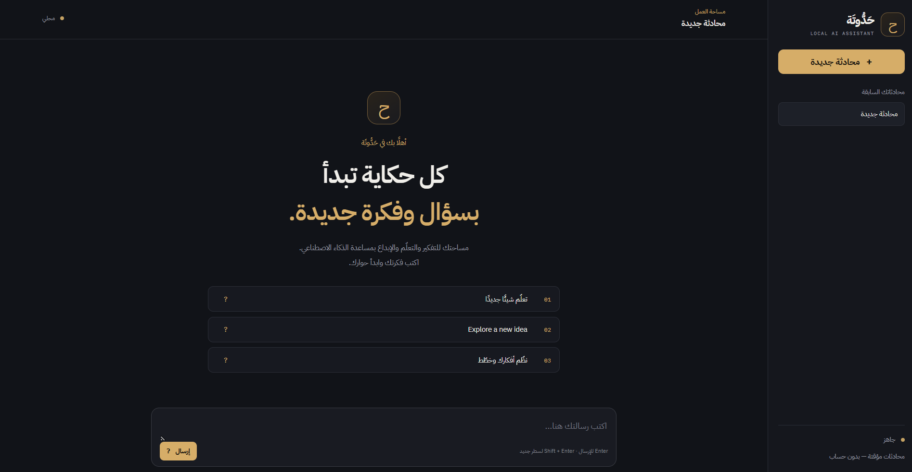
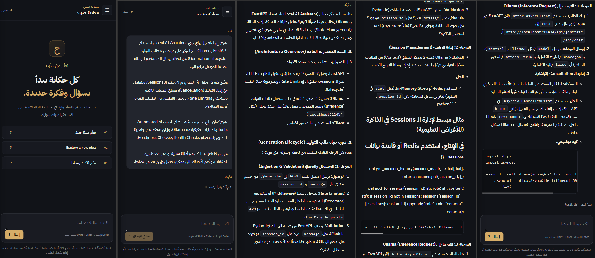
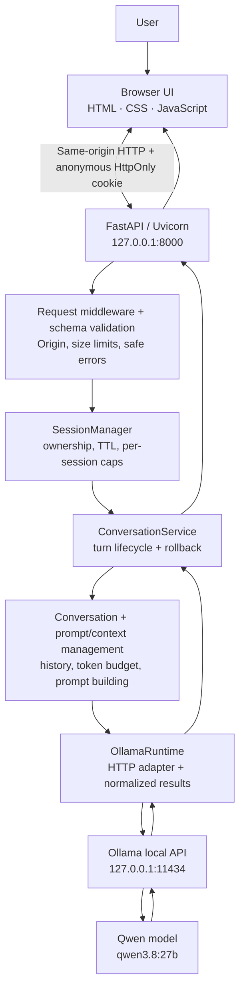
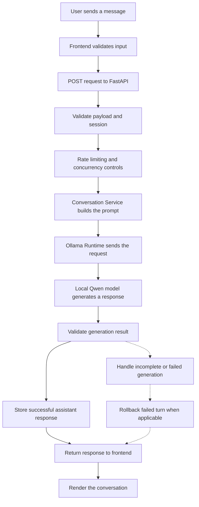

<div align="center">
  
  # حَدُّوتَة | HADOTA
  ### From tokenization experiments to a hardened local AI assistant

  
</p>
  <p>
    <a href="https://github.com/morsycoo/HADOTA"></a>
    
    
    
    
  </p>
  <p>
    
    
    
  </p>
  <p>
    <a href="#live-demo">Live Demo</a> ·
    <a href="#what-is-hadota">What It Is</a> ·
    <a href="#architecture">Architecture</a> ·
    <a href="#the-engineering-journey">The Journey</a> ·
    <a href="#reliability-and-security-engineering">Reliability</a> ·
    <a href="#run-locally">Run Locally</a>
  </p>
</div>

---

## What is HADOTA?

> **HADOTA (حَدُّوتَة)** takes its name from the traditional Egyptian Arabic word of *ḥadūta* for a story or tale. Inspired by a great storyteller's curiosity, HADOTA is a local AI companion designed to make learning, exploring ideas, and having meaningful conversations feel natural and engaging.
More than just an assistant, HADOTA aims to create a personal space for curiosity, whether you're discovering a new concept, asking questions, exploring complex topics, or simply thinking out loud.
HADOTA brings the spirit of a curious storyteller to local AI.

HADOTA is a locally run Arabic/English chat application. It serves a small browser UI and a FastAPI API from one origin, while using the existing local Ollama runtime and the configured `qwen3.8:27b` model. The web app currently uses a **non-streaming request/response path**; streaming in the browser is not claimed as complete.

The project is deliberately more than a chat window. Across a month of development, the work progressed from understanding how text becomes tokens, through real generation and decoding experiments, into a modular Ollama runtime, structured output validation, prompt-regression evaluation, and a responsive FastAPI web application with explicit session and resource controls.

> **Project status:** HADOTA has been exercised locally on Windows with a real Ollama model and an automated test suite. This repository does **not** claim public deployment, cloud hosting, production certification, persistent database storage, or browser-based streaming. Public sharing is intentionally deferred.

### At a glance

| | Project detail |
|---|---|
| **Product** | حَدُّوتَة — HADOTA Local AI Assistant |
| **Experience** | Arabic-first chat with Arabic, English, and mixed-language prompts |
| **Web application** | FastAPI + Uvicorn, serving the UI and API on one origin |
| **Model runtime** | Ollama running locally |
| **Model used in the recorded environment** | `qwen3.8:27b` (approximately 17 GB as reported by Ollama) |
| **Core language** | Python 3.13 |
| **Frontend** | HTML, CSS, vanilla JavaScript |
| **Conversation storage** | Temporary in-memory sessions and conversation histories |
| **Web response mode** | Non-streaming request/response |
| **Recorded verification snapshot** | 366 tests passed, 3 real-Ollama smoke tests passed, 91% reported coverage |

The figures above describe a specific recorded run and development environment. They are evidence from that run, not a promise that every machine, dependency set, or future revision will produce identical results.

---

## Live Demo

### Watch HADOTA in Action

<p align="center">
  <a href="https://github.com/morsycoo/HADOTA/blob/main/assets/HADOTA_Local_AI_Assistant.mp4">
    ▶️ Watch the full HADOTA demo
  </a>
</p>
</div>

### Application screenshots

<table>
  <tr>
    <td align="center" width="100%">
      <strong>01 · Welcome screen</strong><br>
      <sub>Branding, Arabic-first welcome experience, suggested prompts, conversation navigation, and the composer.</sub><br><br>
      
    </td>
  </tr>
  <tr>
    <td align="center">
      <strong>02 · Responsive conversation showcase</strong><br>
      <sub>A composite capture of the narrow-layout chat and a technical conversation about HADOTA's own architecture, sessions, generation lifecycle, and testing.</sub><br><br>
      
    </td>
  </tr>
</table>

> The conversation image is intentionally a composite showcase with multiple narrow views, not a claim that every line of the model's response is readable at the rendered README size. The linked MP4 is the best way to inspect the interaction as a whole.

---

## Why this project matters

A model that produces text is only one part of a usable AI application. A dependable assistant also needs a clear runtime boundary, prompt and context management, validated inputs and outputs, coherent conversation state, recoverable failures, and tests that distinguish simulated behavior from real inference.

HADOTA brings those concerns together:

- **Local inference:** the browser talks to FastAPI; the backend talks to Ollama. The browser does not call the model server directly.
- **Modular runtime design:** the app uses typed generation contracts and an `OllamaRuntime` adapter instead of spreading Ollama-specific HTTP details throughout the application.
- **Token-aware context:** the project studies tokenization and includes context-window management so conversation history can be selected within a configured budget.
- **Structured responses:** JSON mode and JSON Schema generation are followed by application-side parsing and validation.
- **Failure-aware history:** incomplete or failed assistant turns are not treated as successful answers; retry paths are designed to avoid duplicate visible user messages.
- **Bounded work:** request-body, message, session, conversation, rate, and concurrency limits keep resource usage bounded in the local web app.
- **Evidence-led engineering:** educational tensor demonstrations, mocked tests, real-Ollama tests, human browser acceptance, and performance observations are kept conceptually separate.

---

## Architecture

### System architecture



### What happens when a user sends a message?



### Architectural boundaries

| Component | Owns | Deliberately does not own |
|---|---|---|
| `frontend/` | Rendering, user interactions, navigation, retry and continuation UI | Direct communication with Ollama or authoritative session ownership |
| `app/web/main.py` | FastAPI lifecycle, middleware and HTTP routes | Model-specific response parsing spread across route handlers |
| `app/web/sessions.py` | Anonymous sessions, conversation ownership, expiry, locks and limits | Durable database persistence |
| `app/services/conversation_service.py` | Conversation turns, prompt/runtime orchestration, completion checks, commit/rollback | Browser DOM or HTTP presentation details |
| `app/prompt_builder.py` + `app/context/` | Prompt formatting, token counting and context-budget selection | Claims about internal model tensors not exposed by the runtime |
| `app/runtime/ollama_runtime.py` | Ollama HTTP calls, option mapping, streaming normalization, metadata and runtime failures | UI logic or session cookies |
| Ollama | Local model execution | Web session management or frontend state |

### Process and data boundaries

- The intended web bind is `127.0.0.1:8000`; Ollama normally serves its local API on port `11434`.
- FastAPI serves both the frontend and API on the same origin in the local workflow.
- Sessions and conversation histories are stored in process memory. Restarting the web process clears them.
- No database, user account system, hosted inference endpoint, or cross-device history is part of the current scope.
- Runtime/service streaming exists in the lower-level integration, but **the browser chat path is non-streaming**: the UI receives the completed response as one request/response operation.

---

## Feature map

### Chat and interaction

- Arabic-first interface with mixed Arabic/English prompts.
- New-chat workflow and a list of conversations for the current anonymous session.
- Retrieval and deletion of conversations after server-side ownership checks.
- Busy, error, retry, copy-response, and available-continuation interactions.
- Navigation-aware completion: when a response finishes after the user switches views, the active conversation can be reloaded so the completed answer appears in the right place.
- Retry behavior designed to reuse the existing user-message element rather than render a duplicate.
- Responsive layout checked at desktop and a narrow viewport.

### Session and privacy model

- Anonymous, server-generated session identifier carried in a cookie with `HttpOnly` and `SameSite` protections.
- No login, registration, username, or password flow.
- Conversation IDs alone are insufficient to access another session's conversation.
- Best-effort page-close signaling with a grace period; idle and absolute expiry remain authoritative fallbacks.
- Explicit session termination through the session API.
- In-memory history is temporary and is not a durable personal knowledge base.

**Privacy guidance:** do not submit passwords, API keys, confidential business data, or other secrets. This project has not undergone an independent security certification and is not presented as suitable for regulated or sensitive workloads.

### Runtime and output capabilities

- Non-streaming and streaming generation at the runtime/service layer.
- Request/result schemas with normalized text, completion status, token counts, and timing fields where returned by Ollama.
- Runtime error categories for connection failures, timeouts, HTTP errors, invalid responses, missing models, and streaming failures.
- JSON output mode and JSON Schema-constrained requests.
- Application-side validation against JSON Schema or Pydantic models.
- A rule that invalid structured output is handled as a failed operation, not persisted as a successful assistant answer.

---

## The engineering journey

This section is the heart of the repository: seven focused stages, each extending the knowledge and implementation developed before it. The first six stages are documented in Jupyter notebooks; the final stage applies those foundations to the HADOTA web experience and its local closeout.

### 1 — LLM fundamentals and tokenization

**Engineering question:** What does an LLM actually receive as input?

**Work completed**

- Encoded and decoded English, Arabic, mixed-language text, Python code, numbers, punctuation, and longer passages.
- Inspected token strings, token IDs, vocabulary size, and special-token mappings.
- Connected tokens and IDs to embedding vectors, positional information, Transformer blocks, hidden states, logits, and next-token prediction.
- Used small educational tensor experiments to explain embedding-table shapes, self-attention, causal masking, and autoregressive generation.
- Documented the context window as a token-budget constraint.

**Recorded examples from the inspected tokenizer**

| Input | Characters | Words | Tokens |
|---|---:|---:|---:|
| `I love machine learning.` | 24 | 4 | 5 |
| `أنا أحب تعلم الذكاء الاصطناعي.` | 30 | 5 | 10 |
| `أتعلم Machine Learning باستخدام Python.` | 39 | 5 | 7 |
| Python code example | — | — | 14 |
| Numbers + punctuation example | — | — | 24 |
| Longer text example | 792 | 114 | 144 |

**Key lesson:** token counts cannot safely be estimated from character or word counts. The tokenizer used for a model and the exact text matter.

**Evidence boundary:** the toy Transformer and attention experiments are teaching tools. They are not the internal implementation or actual hidden-state tensors of `qwen3.8:27b`.

- Notebook: [`notebooks/01_tokenization.ipynb`](notebooks/01_tokenization.ipynb)
- Guide: [`docs/README_01_Tokenization.md`](docs/README_01_Tokenization.md)

### 2 — Real generation and decoding

**Engineering question:** How does text generation proceed, and what can the runtime actually show us?

**Work completed**

- Sent bounded real generation requests to the local model through Ollama.
- Studied greedy selection, softmax, temperature, top-k sampling, top-p/nucleus sampling, combined sampling, and seeded experiments.
- Traced autoregressive continuation, context growth, stopping conditions, output limits, and completion reasons.
- Collected prompt/output token counts, runtime timing metadata, first-chunk timing, and inter-chunk arrival measurements.
- Created benchmark prompts and an experiment matrix for repeatable comparisons.
- Investigated prefill, decode, and KV-cache concepts, while separating conceptual explanations from directly observed data.

**What the API did not expose:** the tested high-level Ollama path returned generated text and aggregate metadata, not a raw Qwen logits tensor. Logits/probability experiments were therefore explicitly synthetic demonstrations, not falsely presented as real Qwen predictions.

**Recorded investigation note:** a tokenizer loaded through `Qwen3_5Tokenizer` reported a vocabulary of `248,044`, while the inspected model configuration reported `248,320`. The difference of `276` was recorded; its cause was not established during the experiment.

- Notebook: [`notebooks/02_real_generation_and_decoding.ipynb`](notebooks/02_real_generation_and_decoding.ipynb)
- Guide: [`docs/README_02_Real_Generation_and_Decoding.md`](docs/README_02_Real_Generation_and_Decoding.md)
- Experiment data: [`data/generation_benchmark_prompts.json`](data/generation_benchmark_prompts.json), [`data/engineering_observations.json`](data/engineering_observations.json)

### 3 — Local runtime engineering

**Engineering question:** How can the application avoid being coupled to raw Ollama payloads everywhere?

**Work completed**

- Centralized and validated runtime configuration.
- Defined typed `GenerationRequest`, `GenerationResult`, and normalized `StreamEvent` contracts.
- Created a `RuntimeInterface` and an `OllamaRuntime` adapter implemented with `httpx`.
- Mapped supported generation settings such as `num_ctx`, `num_predict`, `temperature`, `top_k`, `top_p`, `seed`, `stop`, `think`, and `keep_alive` where applicable.
- Normalized runtime metadata and failures into application-level contracts and exception types.
- Integrated conversation history, prompt building, context-window management, and the runtime through `ConversationService`.
- Added mocked-runtime tests and separate real-Ollama smoke tests.

**Key lesson:** a runtime adapter is a stable seam between application behavior and one inference provider. It also creates a controllable point for testing failures, normalizing metadata, and adding another runtime later.

- Notebook: [`notebooks/03_local_runtime_engineering.ipynb`](notebooks/03_local_runtime_engineering.ipynb)
- Guide: [`docs/README_03_Local_Runtime_Engineering.md`](docs/README_03_Local_Runtime_Engineering.md)

### 4 — Prompt construction and structured output

**Engineering question:** How do we make a model answer machine-checkable, instead of merely asking it to “return JSON”?

**Work completed**

- Extended generation requests with JSON mode and JSON Schema support.
- Forwarded a requested output format to the Ollama payload where applicable.
- Built reusable parsing and validation paths for JSON Schema and Pydantic models.
- Integrated structured generation into the conversation service.
- Defined explicit error paths for parse, schema, and validation failures.
- Ensured a schema-invalid response is not committed as a successful assistant turn.
- Ran a real-model integration test that returned the requested object structure and passed JSON Schema validation.

**Illustrative response contract**

```json
{
  "answer": "A non-empty string",
  "confidence": 0.87,
  "topics": ["runtime", "validation", "testing"]
}
```

This is an example of the tested contract shape, not a claim about one fixed response for every prompt. JSON validity and schema compliance describe structure; they do not prove factual correctness.

- Notebook: [`notebooks/04_prompt_construction_and_structured_output.ipynb`](notebooks/04_prompt_construction_and_structured_output.ipynb)
- Guide: [`docs/README_04_prompt_construction_and_structured_output.md`](docs/README_04_prompt_construction_and_structured_output.md)
- Validator: [`app/structured_output.py`](app/structured_output.py)

### 5 — End-to-end local AI assistant

**Engineering question:** How do the individually tested pieces work as one useful assistant?

**Work completed**

- Connected runtime configuration, conversation state, prompt building, context-budget management, generation, and response validation into an end-to-end CLI assistant.
- Implemented interactive commands for help, status, statistics, clearing history, streaming mode, JSON mode, and exit.
- Compared streaming and non-streaming generation paths.
- Exercised multi-turn context, runtime status, model availability, structured responses, and failure scenarios.
- Inspected the actual application-level prompt format and made a documented decision based on observed behavior.
- Recorded runtime timing and token metadata while labeling individual measurements as observations, not guarantees.

**Key lesson:** end-to-end integration is not just connecting functions. The application must decide what counts as a completed response, when a message becomes part of history, and how to represent errors to the caller.

- Notebook: [`notebooks/05_end_to_end_local_ai_assistant.ipynb`](notebooks/05_end_to_end_local_ai_assistant.ipynb)
- Guide: [`docs/README_05_end_to_end_local_ai_assistant.md`](docs/README_05_end_to_end_local_ai_assistant.md)

### 6 — Prompt regression and reliability hardening

**Engineering question:** How do we spot a regression and stop an incomplete generation from silently becoming a “successful” answer?

**Work completed**

- Audited the prompt-regression dataset and live regression runner.
- Used 10 documented regression cases across 10 categories; the reviewed default live run selected six cases.
- Distinguished deterministic assertions from human semantic review.
- Reviewed incomplete outputs, token limits, completion reasons, execution failures, and report metadata.
- Added/verified handling around `IncompleteGenerationError` so an unfinished answer is not stored as a successful assistant turn.
- Re-tested history and retry behavior and documented reproducibility limits.

**Recorded regression observation:** a prior `prompt_006` run reached its configured output limit; a later retest with a higher output budget completed with `done_reason = stop`. Both runs remain useful evidence under their respective configurations.

**Key lesson:** a regression pass means the configured assertions passed. It is not a blanket proof of truth, answer quality, or generalized reasoning performance.

- Notebook: [`notebooks/06_regression_evaluation_and_hardening.ipynb`](notebooks/06_regression_evaluation_and_hardening.ipynb)
- Guide: [`docs/README_06_prompt_regression_testing.md`](docs/README_06_prompt_regression_testing.md)
- Dataset: [`data/prompt_regression_cases.json`](data/prompt_regression_cases.json)

### 7 — HADOTA browser chat, lifecycle, and closeout

**Engineering question:** What changes when the assistant becomes a multi-session browser application instead of a CLI?

**Work completed**

- Built the Arabic-first browser interface and same-origin FastAPI API.
- Added anonymous sessions, server-side conversation ownership, conversation listing, and new-chat actions.
- Added a page-close signal with a grace period, explicit session ending, idle expiry, and absolute expiry.
- Added request-body and message-size limits, active-session and conversation caps, sliding-window rate limits, per-conversation operation controls, and a global generation slot.
- Hardened conversation-history reads and writes against races between HTTP handlers, worker threads, generation completion, retry, deletion, and session cleanup.
- Added rollback of failed/incomplete turns and guarded busy responses to avoid duplicate turns or unbounded model work.
- Made `/api/health` a web-process liveness check and `/api/ready` a runtime/model readiness check.
- Added request correlation IDs and safer validation/error responses.
- Captured the welcome screen, narrow viewport, and a real local-model conversation.

**Current frontend boundary:** the chat UI waits for the completed answer. Runtime/service streaming is available below the browser layer, but browser SSE/fetch streaming, disconnect semantics, and stream-specific UI terminal states remain future work.

- Web implementation: [`app/web/main.py`](app/web/main.py), [`app/web/sessions.py`](app/web/sessions.py)
- Frontend: [`frontend/index.html`](frontend/index.html), [`frontend/styles.css`](frontend/styles.css), [`frontend/app.js`](frontend/app.js)
- Hardening guide: [`docs/README_07_hadota_web_chat.md`](docs/README_07_hadota_web_chat.md)
- Closeout guide: [`docs/README_08_HADOTA.md`](docs/README_08_HADOTA.md)

---

## Technology stack

### Application stack

| Layer | Technology | Role |
|---|---|---|
| Language | Python 3.13 | Backend, runtime integration, CLI, tests |
| Web framework | FastAPI | API routes, request validation, app lifecycle |
| ASGI server | Uvicorn | Serves the local web application |
| Inference runtime | Ollama | Runs the language model locally and exposes its HTTP API |
| Language model | `qwen3.8:27b` | Local text generation in the recorded development setup |
| HTTP client | `httpx` | Runtime adapter communication with Ollama |
| Data contracts | Pydantic | Request/result schemas and value validation |
| Structured data | `jsonschema` | JSON Schema validation |
| Token counting | `tokenizers` + local Qwen tokenizer assets | Context-window accounting |
| Testing | `pytest` | Unit, mocked runtime, service, web/session, regression and smoke tests |
| Configuration | `python-dotenv` + environment variables | Environment-driven settings |

### Frontend stack

| Technology | Role |
|---|---|
| HTML | Semantic UI structure and accessible controls |
| CSS | Dark visual system, layout, states and responsive behavior |
| Vanilla JavaScript | API calls, conversation state, rendering, retry, continuation and navigation updates |
| DOMPurify | Sanitization dependency in the local frontend asset setup |
| `marked` | Markdown parser dependency if the matching vendor asset is present and wired into the current build |
| Node.js | `node --check frontend/app.js` syntax check; not needed to serve the app |

The exact frontend rendering behavior depends on which local vendor assets are present in the checked-out repository. This README does not claim that optional Markdown rendering is active if its `marked` asset is absent.

### Learning and experiment stack

| Technology / artifact | Where it is used |
|---|---|
| PyTorch | Educational tensor demonstrations and recorded numerical/hardware experiments |
| Transformers | Tokenizer and model-configuration inspection in notebooks |
| Tokenizers | Direct encoding/decoding and context token counting |
| Synthetic logits | Teaching decoding maths where the high-level Ollama API does not expose logits |
| Jupyter notebooks | Reproducible learning notes, experiments, and recorded evidence |
| JSON datasets/reports | Benchmark prompts, prompt-regression cases, and experiment observations |

> The package versions recorded in the learning notebooks vary by phase. For the current local web runtime, see `requirements.txt`, `requirements-dev.txt`, and the relevant closeout report rather than assuming every notebook package is a runtime dependency.

---

## Reliability and security engineering

The web layer was intentionally designed with bounded local use in mind. The settings below are the documented defaults from the closeout guide; they are guardrails, not measured capacity limits or proof of production readiness.

### Resource policy

| Control | Default | Why it exists |
|---|---:|---|
| Maximum request body | `65,536` bytes (64 KiB) | Reject oversized payloads before normal route parsing, including chunked requests |
| Maximum message size | `4,000` characters | Bound per-message input size |
| Active anonymous sessions | `25` | Bound the in-memory session registry |
| Conversations per session | `5` | Bound history/conversation state per session |
| Idle session TTL | `900` seconds (15 minutes) | Clean up inactive sessions |
| Absolute session lifetime | `14,400` seconds (4 hours) | Enforce a maximum session age even with continued activity |
| Page-close grace period | `30` seconds | Avoid deleting a session on refresh/navigation too eagerly |
| Per-session generation rate | `10` requests / `60` seconds | Limit repeated generation from one session |
| Process-wide generation rate | `20` requests / `60` seconds | Cap aggregate generation requests |
| Concurrent active generations | `1` | Return a retryable busy response rather than allowing unbounded model work |

### API routes

| Method | Route | Purpose |
|---|---|---|
| `GET` | `/api/health` | Web-process liveness; not dependent on an active generation |
| `GET` | `/api/ready` | Checks local runtime connectivity and configured model readiness |
| `POST` | `/api/session` | Creates or resolves the caller's anonymous session and cookie |
| `POST` | `/api/session/close` | Best-effort page-close signal with a grace period |
| `DELETE` | `/api/session` | Ends the caller's current session |
| `POST` | `/api/conversations` | Creates a conversation within the caller's session |
| `GET` | `/api/conversations` | Lists conversations owned by the caller |
| `GET` | `/api/conversations/{conversation_id}` | Retrieves an owned conversation |
| `DELETE` | `/api/conversations/{conversation_id}` | Deletes an owned conversation; may reject a busy operation |
| `POST` | `/api/conversations/{conversation_id}/continue` | Continues an incomplete answer when continuation is available |
| `POST` | `/api/conversations/{conversation_id}/messages` | Sends a user message and waits for the completed response |

The route list reflects the documented local web application. The current source schemas and decorators remain authoritative if routes change later.

### Error and state-handling principles

- **`409 Conflict`:** a conversation is already busy or a continuation state is not valid for the current operation.
- **`413 Payload Too Large`:** the request body exceeds the configured cap.
- **`429 Too Many Requests`:** session/process rate limit or the global generation slot is busy.
- **`503 Service Unavailable`:** local inference is unavailable or the generation did not complete successfully.
- **Generic validation errors:** invalid payload details are not echoed unnecessarily to the caller.
- **Request correlation:** response request IDs help connect a caller-visible failure with server-side diagnostics.
- **Turn rollback:** incomplete, failed or invalid responses are not stored as successful assistant answers.

### The hard bugs that shaped the implementation

| Failure mode / risk | Engineering response | What this does not claim |
|---|---|---|
| Character/word counts do not predict token counts | Inspect the model tokenizer and use token-aware context budgeting | Counts are not universal across model families |
| Ollama's high-level API does not expose raw logits in the tested path | Use actual generated text/metadata for runtime observations and label synthetic distributions as educational | Synthetic logits are not Qwen's true internal scores |
| Output stopped at a token limit | Inspect completion state; incomplete generations are treated as incomplete, not successful | A stop reason alone cannot guarantee semantic answer quality |
| Invalid JSON despite a structured-output request | Parse and validate against JSON Schema or Pydantic before commit | Schema-valid output is not necessarily true |
| Retry after failure could duplicate a user turn | Reuse the visible message element and roll back a failed/incomplete turn as appropriate | This does not eliminate every possible model-quality failure |
| Navigation could replace a DOM node while generation completed | Reload the active transcript when needed so the result appears in the correct conversation | Browser streaming is not implemented by this navigation fix |
| Shared history might be read/written across async handlers and worker threads | Synchronize history operations and scope operations with locks | It does not make in-memory state persistent across restart |
| Lock-order inversion could delay session cleanup/deletion | Change cleanup lock ordering and move potentially waiting work off the ASGI event loop | It does not imply a formal deadlock proof for every future change |
| Cancellation could release a slot while a worker still mutates history | Wait for the actual worker to finish before releasing its operation context | Cancelling the HTTP coroutine does not necessarily cancel inference already running inside Ollama |
| Multiple requests could over-consume a local model | Use non-blocking conversation operations, rate limits, and a single global generation slot | The policy is not a hardware benchmark or a general anti-abuse guarantee |
| A browser close event may never arrive | Use it as a best-effort signal; idle/absolute TTLs remain authoritative | Session cleanup does not rely solely on page unload |
| Liveness could be confused with model readiness | Split `/api/health` from `/api/ready` | A healthy web process does not prove the model can generate |

---

## Model experiments: observed vs. simulated

An important engineering rule throughout the notebooks was to mark the boundary between what the runtime showed and what was used to teach a concept.

| Topic | Evidence used | Interpretation |
|---|---|---|
| Tokenization | Actual tokenizer output and token IDs for recorded examples | Observed for the inspected tokenizer/version and specific inputs |
| Model generation | Real text responses and Ollama metadata | Actual local-model requests from the recorded environment |
| Sampling math | Synthetic logits and probabilities | Educational calculation, not raw Qwen logits |
| Prefill/decode/KV cache | Runtime timing metadata plus conceptual explanation | Internal details not fully observable from the tested high-level API |
| First-token/chunk timing | Client-observed request and chunk timestamps | Measurement includes client/runtime overhead; not a pure hardware metric |
| Prompt regression | Configured checks against selected response outputs | Proves the assertions that ran, not general factual correctness |
| JSON Schema validation | Parsed output checked against an explicit schema | Proves structure/constraints, not truth or semantic usefulness |

This distinction keeps the project technically honest and makes the experiment notebooks more valuable as learning material.

---

## Verification and results

### Recorded closeout snapshot

| Check | Result | What it means |
|---|---:|---|
| Full automated suite | **366 passed** in **84.15 s** | All collected tests in that recorded full-suite run passed |
| Real Ollama smoke tests | **3 passed** in **37.38 s** | The configured local runtime/model completed the selected smoke tests |
| Overall coverage | **91%** | Recorded coverage report: 1,504 statements, 142 missed |
| Python compilation | Passed | `compileall` completed for the checked application/test paths |
| JavaScript syntax | Passed | `node --check frontend/app.js` passed |
| Dependency consistency | Passed | `pip check` reported no broken requirements |
| `GET /api/health` | HTTP 200 | The web app responded to liveness request |
| `GET /api/ready` | Ready | The configured runtime/model was available during that check |
| Welcome screenshot | Captured | Actual local UI screenshot produced |
| Narrow viewport screenshot | Captured | Responsive layout screenshot produced |
| Conversation screenshot | Captured | The closeout run recorded a real local-model reply |

These measurements come from the local Windows environment and the supplied closeout output. They are a historical evidence snapshot, not a guarantee of the present machine state or of performance on another system.

### Re-run the checks

From the repository root in PowerShell:

```powershell
python -m compileall -q app tests
node --check .\frontend\app.js
python -m pip check
python -m pytest .\tests -q
```

Real-Ollama tests require Ollama to be running and the model to be available. Run them separately when you want to distinguish deterministic application failures from local runtime/model availability:

```powershell
python -m pytest .\tests\test_ollama_runtime_smoke.py -q
python -m pytest .\tests\test_ollama_streaming_smoke.py -q
```

A runtime smoke test can take longer than a mocked test because it actually loads or invokes a large model. Do not compare one-run latencies as if they were controlled benchmarks.

---

## Run locally

### Prerequisites

- Windows with Python 3.13 available.
- Ollama installed and running locally.
- The configured model `qwen3.8:27b` available in `ollama list`.
- The repository's runtime and development dependencies installed.
- Node.js only if you also want to run the JavaScript syntax check.

### 1. Verify the local runtime

```powershell
python --version
ollama --version
ollama list
ollama ps
```

If the model is not installed, pull it using Ollama:

```powershell
ollama pull qwen3.8:27b
```

The model download is large. Disk use, load time, memory use, and response latency depend on the machine and Ollama configuration.

### 2. Create a virtual environment

```powershell
python -m venv .venv
.\.venv\Scripts\Activate.ps1
python -m pip install --upgrade pip
```

### 3. Install project dependencies

```powershell
python -m pip install -r .\requirements.txt
python -m pip install -r .\requirements-dev.txt
python -m pip check
```

`requirements.txt` and `requirements-dev.txt` specify compatible version ranges rather than a fully locked environment. Notebook dependencies can differ from the minimal runtime dependency set.

### 4. Start HADOTA

Make sure Ollama is running and the configured model is available. Then:

```powershell
python -m uvicorn app.web.main:app --host 127.0.0.1 --port 8000
```

Open [http://127.0.0.1:8000](http://127.0.0.1:8000).

Stop the application with `Ctrl+C` in the server terminal.

### 5. Check liveness and readiness

In another PowerShell window:

```powershell
Invoke-RestMethod "http://127.0.0.1:8000/api/health"
Invoke-RestMethod "http://127.0.0.1:8000/api/ready"
```

`/api/health` answers “is the web process alive?”; `/api/ready` answers “is the configured inference runtime/model available?” They are intentionally different checks.

---

## Project structure

This is the conceptual layout of the repository. Large local tokenizer assets and generated reports may vary by checkout.

```text
HADOTA/
├── app/
│   ├── cli.py                         # Earlier interactive CLI
│   ├── config.py                      # Runtime, web, session and resource settings
│   ├── conversation.py                # Conversation history operations
│   ├── prompt_builder.py              # Role-labelled prompt construction
│   ├── schemas.py                     # Generation request/result contracts
│   ├── structured_output.py           # JSON and schema validation
│   ├── context/
│   │   ├── token_counter.py           # Tokenizer-backed token counting
│   │   └── window_manager.py          # Token-budget-aware context selection
│   ├── runtime/
│   │   ├── base.py                    # Runtime interface
│   │   ├── ollama_runtime.py          # Ollama HTTP adapter
│   │   └── exceptions.py              # Normalized runtime failure types
│   ├── services/
│   │   └── conversation_service.py    # Turn lifecycle and generation orchestration
│   └── web/
│       ├── main.py                    # FastAPI app, routes, middleware and lifecycle
│       ├── schemas.py                 # Web API contracts
│       └── sessions.py                # Anonymous session and conversation registry
├── assets/
│   ├── hadota-hero.jpg                # Product visual / README hero
│   ├── hadota-local-welcome.png       # Desktop welcome screenshot
│   ├── hadota-mobile-conversation.png # Responsive conversation showcase
│   ├── HADOTA_Local_AI_Assistant.mp4  # Recorded product demo
│   └── tokenizers/qwen3.8-27b/         # Local tokenizer assets, if distributed
├── data/
│   ├── generation_benchmark_prompts.json
│   ├── engineering_observations.json
│   ├── prompt_regression_cases.json
│   └── final_summary.md
├── docs/                               # Phase-by-phase technical guides
├── frontend/
│   ├── index.html                     # Web app markup
│   ├── styles.css                     # UI styling / responsive layout
│   ├── app.js                         # Browser behavior and API calls
│   └── vendor/                        # Local frontend dependencies/manifest
├── notebooks/
│   ├── 01_tokenization.ipynb
│   ├── 02_real_generation_and_decoding.ipynb
│   ├── 03_local_runtime_engineering.ipynb
│   ├── 04_prompt_construction_and_structured_output.ipynb
│   ├── 05_end_to_end_local_ai_assistant.ipynb
│   └── 06_regression_evaluation_and_hardening.ipynb
├── reports/                            # Test, regression, closeout and screenshot artifacts
├── tests/                              # Unit, mock, API, regression and runtime smoke tests
├── requirements.txt
├── requirements-dev.txt
└── README.md
```

---

## Configuration reference

The primary settings are defined in `app/config.py`. These are the documented local defaults; actual values can be overridden by environment variables.

| Setting | Default | Purpose |
|---|---:|---|
| `OLLAMA_HOST` | `http://127.0.0.1:11434` | Ollama API URL |
| `MODEL_NAME` | `qwen3.8:27b` | Model identifier |
| `REQUEST_TIMEOUT_SECONDS` | `120` | Runtime request timeout |
| `KEEP_ALIVE` | `5m` | Ollama model retention setting |
| `THINK` | `false` | Thinking option where supported |
| `NUM_CTX` | `4096` | Configured context window |
| `MAX_NEW_TOKENS` | `512` | Web generation output budget in documented closeout config |
| `TEMPERATURE` | `0.0` | Generation temperature |
| `PUBLIC_MODE` | `false` | Keep disabled for local-only use |
| `COOKIE_SECURE` | `false` locally | Local HTTP cookie policy; public mode requires secure cookies |
| `ALLOWED_ORIGINS` | empty locally | Exact origin allowlist; public mode requires valid HTTPS origins |
| `MAX_REQUEST_BODY_BYTES` | `65,536` | API request body limit |
| `MAX_MESSAGE_CHARS` | `4,000` | Message length limit |
| `MAX_ACTIVE_SESSIONS` | `25` | Concurrent in-memory session cap |
| `MAX_CONVERSATIONS_PER_SESSION` | `5` | Conversation count per session |
| `SESSION_IDLE_TTL_SECONDS` | `900` | Idle expiry |
| `SESSION_ABSOLUTE_TTL_SECONDS` | `14,400` | Maximum session lifetime |
| `SESSION_RATE_LIMIT_REQUESTS` | `10` | Per-session generation requests per window |
| `SESSION_RATE_LIMIT_WINDOW_SECONDS` | `60` | Per-session rate window |
| `GLOBAL_GENERATION_RATE_LIMIT_REQUESTS` | `20` | Process-wide generation requests per window |
| `GLOBAL_GENERATION_RATE_LIMIT_WINDOW_SECONDS` | `60` | Global rate window |
| `MAX_ACTIVE_GENERATIONS` | `1` | Global concurrent-generation limit |

These are resource guardrails, not measured throughput limits. Public mode has additional validation requirements, but public exposure is outside the scope of this project closeout.

---

## Known limitations and deliberately deferred work

- **Local-only application:** cloud hosting and public internet access are not part of the current implementation.
- **No durable sessions:** session state and conversation history are held in process memory and disappear when the server process restarts.
- **No account system:** sessions are anonymous and temporary.
- **No browser streaming:** the browser chat uses completed request/response calls even though the runtime/service layer supports streaming generation.
- **Upstream inference cancellation:** cancelling the HTTP/request coroutine does not guarantee that inference already started inside Ollama is cancelled. The application protects its state/resource lifecycle while work is still running.
- **Model and hardware dependency:** response quality, startup cost, and latency depend on the local Ollama process, model artifact, hardware, and workload.
- **Tokenizer parity uncertainty:** the recorded tokenizer/config vocabulary difference of 276 was not resolved, and tokenizer counts should be interpreted for the specific tokenizer artifact used.
- **No raw logits from tested endpoint:** synthetic logits are explanatory experiments only.
- **Structured output is not truth verification:** schema checks constrain shape and types, not factual accuracy.
- **Regression coverage is bounded:** the live default run selected six of ten documented cases; assertions and human review are not interchangeable.
- **Performance observations are not controlled benchmarks:** individual TTFT, chunk intervals, and generation durations vary and should not be generalized from one or two runs.
- **Frontend Markdown assets:** rich Markdown rendering depends on the expected local vendor assets being included; do not assume optional rendering dependencies exist if the file is absent.
- **No production certification:** the work provides meaningful local hardening and test evidence, but does not claim a formal external security audit or public production readiness.

---

## Engineering takeaways

1. **Observe what the runtime actually exposes.** Do not call synthetic logits “model output” or confuse client timing with pure model-kernel timing.
2. **Treat completion as a contract.** A response that reaches a length limit may be incomplete; validate completion before persisting it.
3. **Validate at multiple boundaries.** Pydantic request validation, JSON parsing, JSON Schema validation, and model output completion checks solve different problems.
4. **Conversation history is shared mutable state.** Async routes, worker threads, session cleanup, deletion, retry, and continuation need a deliberate locking and rollback policy.
5. **Cancellation is not magic.** The web request can be cancelled while an inference operation is still active; resource slots and state locks must reflect the actual worker lifecycle.
6. **Local-first still requires resource protection.** A model running on a personal machine can be overloaded; body limits, rate limits, session caps, and a generation slot still matter.
7. **UI correctness is part of system reliability.** Navigation, retry, and responsive states are not merely cosmetic; they determine whether completed results are associated with the right user action.
8. **Passing tests have a defined scope.** Automated assertions, live model runs, and human UX checks should be reported separately.

---

## Documentation index

| Resource | Why open it |
|---|---|
| [`notebooks/01_tokenization.ipynb`](notebooks/01_tokenization.ipynb) | Token IDs, embeddings, attention, and context fundamentals |
| [`notebooks/02_real_generation_and_decoding.ipynb`](notebooks/02_real_generation_and_decoding.ipynb) | Real Ollama generation, decoding experiments and runtime timing |
| [`notebooks/03_local_runtime_engineering.ipynb`](notebooks/03_local_runtime_engineering.ipynb) | Runtime interfaces, adapter, contracts, errors and streaming |
| [`notebooks/04_prompt_construction_and_structured_output.ipynb`](notebooks/04_prompt_construction_and_structured_output.ipynb) | JSON mode, JSON Schema, Pydantic, and response validation |
| [`notebooks/05_end_to_end_local_ai_assistant.ipynb`](notebooks/05_end_to_end_local_ai_assistant.ipynb) | CLI end-to-end integration and prompt-format audit |
| [`notebooks/06_regression_evaluation_and_hardening.ipynb`](notebooks/06_regression_evaluation_and_hardening.ipynb) | Prompt-regression audit and incomplete-generation hardening |
| [`docs/README_07_hadota_web_chat.md`](docs/README_07_hadota_web_chat.md) | Browser lifecycle, session safety, and API hardening |
| [`docs/README_08_HADOTA.md`](docs/README_08_HADOTA.md) | Closeout status, local setup, settings, and route documentation |
| [`data/prompt_regression_cases.json`](data/prompt_regression_cases.json) | The prompt-regression cases used by the live runner |
| [`data/generation_benchmark_prompts.json`](data/generation_benchmark_prompts.json) | Generation prompts for recorded experiments |
| [`reports/`](reports/) | Generated test reports, screenshots, and logs if present in this checkout |

---

## 👨‍💻 About the Author

<div align="center">

# Mahmoud Morsy

### AI Engineer | LLM Applications | Machine Learning

*Building practical AI systems from model experimentation to reliable, user-facing applications.*

<br>

<a href="https://github.com/morsycoo">
  
</a>
<a href="https://www.linkedin.com/in/morsycoo">
  
</a>

</div>

---

### 🧠 Areas of Interest

| Area                                 | Focus                                                                      |
| ------------------------------------ | -------------------------------------------------------------------------- |
| **Large Language Models**            | Local inference, prompt engineering, structured generation, and evaluation |
| **AI Engineering**                   | Application architecture, API integration, reliability, and testing        |
| **Machine Learning & Deep Learning** | Model experimentation, evaluation, and performance analysis                |
| **Natural Language Processing**      | Text processing, tokenization, and language-model applications             |
| **Computer Vision**                  | Image understanding and object-detection systems                           |
| **MLOps & Deployment**               | Reproducibility, runtime optimization, and deployment workflows            |
| **Data Science**                     | Data analysis, experimentation, and evidence-driven decisions              |

### 🚀 Engineering Philosophy

I focus on understanding how AI systems work beyond the model itself: how data is processed, how inference is executed, how components communicate, and how applications are tested for reliability.

HADOTA represents this approach by bringing together local LLM inference, a web interface, backend engineering, session management, request controls, and automated testing in one project.

### 🤝 Let's Connect

If you're interested in AI engineering, LLM applications, open-source projects, or technical collaboration?

Reach out through **[GitHub](https://github.com/morsycoo)** or **[LinkedIn](https://www.linkedin.com/in/morsycoo)**.

---
<div align="center">

# ⭐ Thank You for Visiting ⭐
  <strong>حَدُّوتَة ... كل حكاية تبدأ بسؤال وفكرة جديدة.</strong><br>
A local assistant built with curiosity, engineering discipline, and evidence.
If this repository helped you learn something new or inspired your own projects, consider giving it a ⭐ on GitHub.

Happy Coding! 🚀
